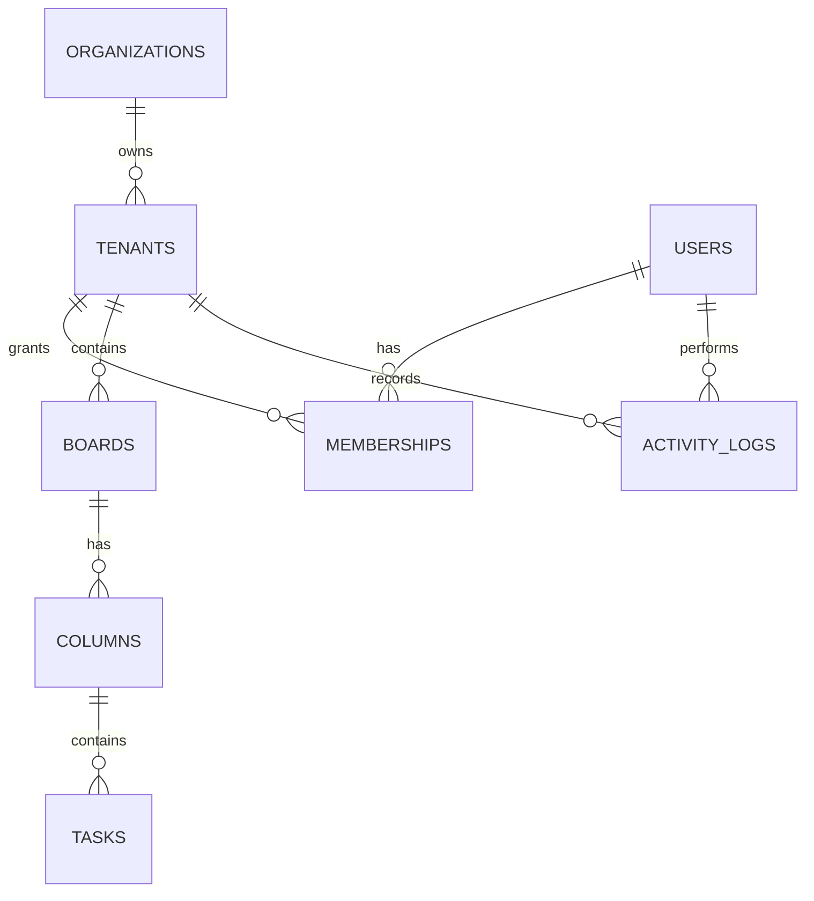

# Flowboard

A real-time collaborative Kanban board demonstrating strict organization and branch (tenant) isolation.

## Run locally

```bash
npm install
npm start
```

Open `http://localhost:3000`. The seeded demo users are:

- `admin@acme.test` (tenant admin)
- `member@acme.test` (member)

The demo API uses `Authorization: Bearer <email>` as a deliberately simple authentication seam. Replace `currentUser()` with the application's identity provider before production use.

## Deploy to Render free tier

1. Push this repository to GitHub.
2. In Render, choose **New → Blueprint** and connect the GitHub repository.
3. Render detects [`render.yaml`](./render.yaml), creates a free web service, and runs `npm install` followed by `npm start`.
4. Open the generated `onrender.com` URL.

The SQLite database is local to the service instance and may be reset when a free instance is restarted or redeployed. For durable production data, use a managed PostgreSQL database and update the database adapter. The free service may also spin down after inactivity, so the first request can take several seconds.

## Architecture

- **Node HTTP server:** REST endpoints and static frontend assets.
- **SQLite:** foreign keys, tenant-scoped indexes, append-only activity records, and integer `version` fields.
- **WebSocket:** clients authenticate before the upgrade and join only the requested tenant channel. Task changes broadcast only to that tenant.
- **Vanilla frontend:** optimistic drag-and-drop, task editing, live refresh, presence, and activity panel.

Every business query includes `tenant_id` or derives it from the entity before authorization. A stale `If-Match`/`version` update returns `409`, allowing the client to reload and resolve the conflict instead of overwriting newer work.

## API

| Method | Route | Purpose |
|---|---|---|
| GET | `/api/session` | Current demo user |
| GET | `/api/organizations` | User's organization |
| GET | `/api/tenants` | Tenants the user belongs to |
| POST/DELETE | `/api/tenants` | Create or remove a tenant (tenant admin) |
| GET | `/api/boards?tenant_id=` | Boards in an accessible tenant |
| POST/DELETE | `/api/boards` | Create or remove a board |
| POST/DELETE | `/api/columns` | Create or remove a column |
| GET | `/api/board/:id?tenant_id=` | Board, columns, and ordered tasks |
| POST/PATCH/DELETE | `/api/tasks` | Create, update, or remove a task |
| PATCH | `/api/tasks/:id` | Update a task with `If-Match: <version>` |
| GET | `/api/activity?tenant_id=` | Latest tenant activity |
| WS | `/ws?tenant_id=` | Scoped updates and presence |

## Data model



`position` is an indexed integer ordering key. For large-scale deployments, replace it with a fractional/rank key and use PostgreSQL row-level security or a service-level tenant transaction boundary.

## Trade-offs and next steps

The sample intentionally keeps authentication and provisioning small so the tenancy and synchronization behavior is visible. Production hardening should add OIDC/JWT verification, rate limiting, CSRF protection for cookie auth, schema validation, pagination, Redis pub/sub for multiple WebSocket processes, and integration tests for cross-tenant access and stale writes.
